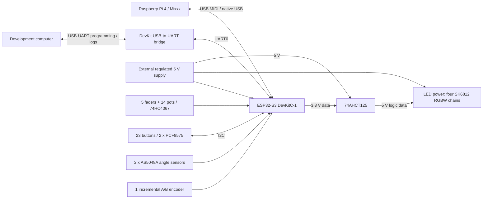

# DJ MIDI Controller — Project Design Baseline

**Status:** Active working baseline for prototyping; not released for PCB design.   
**Review requirement:** Electrical assumptions and the blocking items below require verification against the exact boards and component datasheets before the relevant build stage.

## 1. Purpose and scope

Build a custom DJ/MIDI controller around an ESP32-S3 DevKitC-1, connected to a Raspberry Pi 4 running Mixxx over USB MIDI. The ESP32 reads physical controls and drives LED indicators. Firmware uses a stable MIDI control table; Mixxx maps those messages to DJ actions and provides LED feedback where required.

Wi-Fi/BLE are not part of the current implementation. Keep them as possible future extensions; prefer ADC1 for analog controls and re-check resource constraints before enabling wireless features.

The immediate path is a small breadboard prototype followed by a complete point-to-point (“flying wire”) assembly. PCB work is deferred until both physical prototypes have passed their tests. The final ESP32 pinout is intentionally not frozen.

## 2. System architecture



### Project baseline decisions (not all hardware-verified)

| Area | Baseline |
|---|---|
| MCU | ESP32-S3-DevKitC-1; exact board and module variant remain to be verified. |
| Host | Raspberry Pi 4, acting as USB host. |
| USB | Native USB port connects to the Raspberry Pi for USB MIDI. The separate USB-to-UART port is for firmware upload, serial logs and debug. This board has two USB connectors; verify exact power behavior before connecting both hosts or external 5 V at the same time. |
| Power | External regulated 5 V supply powers the controller. USB VBUS must not be tied to this 5 V rail. Grounds are common. |
| Analog controls | 14 x 10 kΩ potentiometers through one 74HC4067, plus 5 direct ADC faders. Prefer ADC1 inputs. |
| Buttons | 23 button inputs through two PCF8575 expanders on I2C. |
| Rotary controls | Two jog wheels use one AS5048A angle sensor and one momentary tactile mode switch each; each switch independently toggles its jog between NUDGE and SCRATCH. A third incremental A/B encoder selects tracks in Mixxx. The jog switches and the track encoder's push switch use PCF8575 inputs; the push-switch function remains TBD. Sensor interface and magnet/mounting details remain to be verified. |
| LEDs | 40 x 5 V SK6812 RGBW in four independent chains of 10. |
| Level shifting | One 74AHCT125, powered at 5 V, for the four LED data lines. |
| Build order | Breadboard/prototype first; PCB only after the prototype gates pass. |

## 3. USB and power boundary

### USB MIDI

The DevKitC-1 has two USB connectors with different roles:

| Connector | Role | Connection |
|---|---|---|
| Native ESP32-S3 USB | USB Full-Speed device; USB MIDI and control/feedback data | Connect to the Raspberry Pi. ESP32-S3 D− = GPIO19 and D+ = GPIO20. |
| USB-to-UART bridge | Firmware upload, serial logs and debug | Connect to a development computer when needed; this is separate from the MIDI data connection. |

Use the board's connectors rather than wiring USB D+/D− directly to loose GPIO wires. Verify the exact DevKitC revision and schematic before wiring. The ESP32 should enumerate as a USB MIDI device. Control events travel to the Pi; MIDI output from the Pi may provide LED feedback. MIDI message mapping and the exact firmware USB stack remain open.

The native USB and USB-to-UART connectors may be connected to separate hosts, but the board's 5 V/VBUS paths must be checked before doing so, especially when the external 5 V supply is also connected. Do not assume that either connector is data-only or that the two VBUS nets are isolated.

### Separate power

The external 5 V supply powers the ESP32 board through its documented power input, the SK6812 chains, and the 74AHCT125. Use the DevKit's 3.3 V rail for the PCF8575 devices, 74HC4067 and potentiometers, subject to the board regulator's current limits. Never feed 5 V into the 3V3 pin. Verify the selected DevKit's power path while USB is connected; do not connect host USB VBUS to the external 5 V rail. Connect USB ground and controller ground as required for the data interface.

**USB VBUS sensing is unresolved.** A self-powered device still needs a verified method for detecting host VBUS and handling attach/detach. Do not treat “D+, D− and GND only” as a complete USB design until the VBUS-sense arrangement is specified and tested. The host VBUS sense path must not become a power path from the host, and the external supply must not feed power back to the Pi through USB.

A cut cable may be used only for a controlled bench test after verifying VBUS isolation, VBUS detection, grounding and data wiring. It is not the final connector solution.

### Supply sizing and safety

The planning estimate is 80 mA per LED at maximum RGBW load:

- 40 x 80 mA = 3.2 A for LEDs;
- 3.2 A x 5 V = 16 W;
- a 5 V / 5 A supply leaves nominal margin for the MCU and logic.

This is a conservative estimate, not a measured load. Verify the actual LED part's current and the complete system's peak load. Do not route LED current through a breadboard. Use appropriately rated conductors and separate power branches for the LED chains and logic; keep LED return current from corrupting analog ground measurements.

The Mean Well RS-25-5 is a candidate supply, not a mandatory selection. Any mains-powered supply must be installed with suitable enclosure, strain relief and protective-earth/fusing arrangements. A certified enclosed 5 V adapter is preferable for initial bench work.

## 4. Inputs

### Potentiometers and faders

- Power potentiometers from 3.3 V and ground; route wipers only to inputs that remain within the ESP32 ADC voltage limits.
- Power the 74HC4067 from 3.3 V. Connect channels CH0–CH13 to the 14 potentiometers; CH14–CH15 remain spare. Route SIG to one ADC input.
- Connect each of the five faders to a separate ADC1 input where the selected board exposes a suitable pin.
- After selecting a 4067 channel, allow the signal to settle before sampling. Validate settling time and ADC noise on the actual wiring; filtering/deadband are firmware behavior, not a substitute for correct electrical levels.
- Firmware processing: sample -> allow settling (and discard the first sample after mux switching if testing shows it is needed) -> filter -> deadband/hysteresis -> calibrate and map the nominal 12-bit range (0–4095) to MIDI 0–127 -> send the configured MIDI CC. Validate the real endpoints and noise before fixing thresholds.
- Do not send unfiltered raw ADC changes as MIDI events.

### Buttons and PCF8575

The current 23-input allocation comprises 20 panel buttons, two jog-mode switches, and the track-selection encoder push switch (its function remains TBD). Use two PCF8575 devices:

- PCF8575 #1: 16 panel buttons.
- PCF8575 #2: 4 panel buttons, 2 jog-mode switches, the track-encoder push switch and 9 spare inputs.

Use distinct I2C addresses and set the address pins explicitly. Button wiring is input pin to button to ground, relying on the PCF8575 quasi-bidirectional input behavior. The initial design does not add one external 10 kΩ pull-up per button. Verify button levels and noise during breadboard and flying-wire tests; add external button pull-ups only if measurements show they are needed. Initialize used PCF8575 pins appropriately and verify the behavior with the selected parts or modules.

This button-input choice does not remove the separate I2C bus requirement: **SDA and SCL pull-ups must be present at 3.3 V.** Check whether the selected breakout boards already provide them. If using bare ICs, add one correctly sized pull-up pair for the bus; avoid unintentionally paralleling several breakout pull-ups. The pull-up value and bus speed must suit the actual bus capacitance and wiring.

The two PCF8575 INT outputs may share one ESP32 input if the selected parts' interrupt outputs are open-drain and the shared line has a 3.3 V pull-up. Read both expanders when the shared interrupt is asserted. Verify interrupt clearing behavior against the part datasheet.

Implement deterministic software debounce for mechanical buttons.

### Jog wheels and track selection

Use one AS5048A absolute angle sensor per jog wheel. Each wheel has its own momentary tactile switch; a debounced press toggles that wheel independently between NUDGE and SCRATCH. The selected magnet listing is for an N38, 8 mm × 3 mm, diametrically magnetized NdFeB disc. Confirm this magnet's suitability, the exact sensor package/module, data interface, air gap and alignment against the selected datasheet before wiring. Firmware derives signed movement from successive angle samples and must handle angle wrap-around, direction calibration, noise and update rate before producing MIDI events.

Use a third mechanical incremental A/B encoder to browse tracks in Mixxx. Route its A/B signals directly to ESP32 GPIO; internal pull-ups are the initial prototype choice. Add external pull-ups or filtering only if testing shows they are needed. Decode with interrupts or sufficiently frequent polling. The track encoder's push-switch function remains TBD; its input stays on the PCF8575.

## 5. LED subsystem

Use four independent chains, each with 10 SK6812 RGBW LEDs:

- MAIN L
- MAIN R
- DECK A
- DECK B

| 74AHCT125 channel | LED chain |
|---|---|
| 1 | MAIN L |
| 2 | MAIN R |
| 3 | DECK A |
| 4 | DECK B |

Power the LEDs directly from the 5 V supply. Each chain receives a separate data output from the 74AHCT125, followed by a series resistor near the first LED; 330 Ω is the current target, with 220–470 Ω as the prototype adjustment range. Power the AHCT125 from 5 V and verify its output-enable pins are held in the enabled state. Add 100 nF local decoupling at each IC. The 1 µF X7R and 10 µF capacitors listed in the earlier drafts are available for local rail decoupling as required by the final schematic and datasheets. A 470–1000 µF bulk capacitor at the LED power entry is a prototype target; it is not required for the single-LED V0.1 test.

Test the LED system at controlled brightness before full-load operation. Measure current, supply droop and temperature. Do not assume the 80 mA-per-pixel estimate is the exact draw of the selected strip.

## 6. Provisional GPIO concept

This is a starting point only and must not be used to release a PCB:

| Function | Candidate GPIO |
|---|---|
| Five faders | 1, 2, 4, 5, 6 |
| 74HC4067 SIG | 7 |
| 74HC4067 S0–S3 | 8, 9, 10, 11 |
| I2C SDA/SCL | 12, 13 |
| Shared PCF8575 INT | 14 |
| USB D− / D+ | 19 / 20, native USB only |
| GPIO34 | Candidate digital I/O only; not an ESP32-S3 ADC channel; currently unassigned pending module/board confirmation |
| AS5048A interface, track-encoder A/B, and four LED data outputs | TBD after exact board/module and sensor-interface confirmation |

GPIO34 must not be used for an analog control. Confirm it is exposed and available on the selected module before assigning it to a digital input/output.

Treat GPIO38 and any GPIO connected to the onboard RGB LED as reserved until the exact board revision and schematic are checked. Do not count the onboard LED as one of the four external SK6812 chains.

Before assigning remaining pins, check module flash/PSRAM use, board revision, onboard RGB LED wiring, ADC capability and boot/strapping constraints. Avoid GPIO0, GPIO3, GPIO45 and GPIO46 unless their use is specifically verified for the selected board and boot configuration. GPIO35–37 availability varies by module configuration.

## 7. Firmware boundaries

Keep hardware acquisition separate from MIDI mapping and LED behavior:

```text
Hardware drivers -> Input processing -> Logical events -> MIDI mapping
                                            └----------> LED engine
```

Logical events include `BUTTON_DOWN`, `BUTTON_UP`, `JOG_MOVED`, `JOG_MODE_CHANGED`, `TRACK_SELECT_PREVIOUS`, `TRACK_SELECT_NEXT`, `POT_CHANGED` and `FADER_CHANGED`. Keep MIDI note/CC numbers out of low-level drivers so the stable firmware MIDI table can change without rewriting hardware acquisition.

Initial mapping intent uses a stable table in firmware; exact message numbers and jog-wheel encoding must be validated with the selected Mixxx version:

- Pots and faders -> MIDI CC.
- Panel buttons and jog-mode switches -> MIDI Note or MIDI CC as specified by the table.
- Jog wheels -> Mixxx-compatible messages for the selected per-wheel NUDGE or SCRATCH mode.
- Track-selection encoder -> relative MIDI messages for browsing the Mixxx track list.

The LED engine exposes logical channels (`MAIN_L`, `MAIN_R`, `DECK_A`, `DECK_B`) and modes such as VU, peak, static and off. V1 does not perform direct audio analysis on the ESP32; the Pi/DJ software supplies feedback over the defined MIDI path. Exact MIDI feedback messages remain a firmware/software integration decision.

## 8. Prototype and release gates

### V0.1 — proof of concept

Use one ESP32-S3, one PCF8575, one panel button, one AS5048A jog sensor with its tactile mode switch, one incremental track encoder, one potentiometer, one SK6812 and USB MIDI. Verify firmware upload and serial logging through the USB-to-UART connector, then verify USB MIDI enumeration through the native USB connector. Also test I2C addressing and bus pull-ups, button/interrupt/debounce behavior without per-button external pull-ups, jog angle direction and wrap-around, independent mode toggling, track-encoder direction, ADC readings and LED data. USB MIDI testing is gated on resolving the VBUS-sensing and power-path items below.

### V0.2 — complete input set

Add both PCF8575 devices, all 23 button-like inputs, both AS5048A jog sensors and mode switches, the incremental track encoder, 14 potentiometers, five faders and the 74HC4067. Test simultaneous inputs, missed/duplicate events, jog response, ADC noise and MIDI event rate.

### V0.3 — complete LED system

Add the 74AHCT125 and four 10-LED chains. Test data integrity, color/brightness, peak current, supply droop and thermal behavior. Keep brightness limited until the power path is measured.

### V0.4 — Pi/software integration

Verify USB MIDI input/output with Mixxx, host enumeration after reconnect, track browsing, each jog wheel's independent NUDGE/SCRATCH mode, LED feedback and stability during an extended run. Record measured control latency and any dropped events.

### V0.5 — integrated point-to-point assembly

After the breadboard tests, assemble the complete controller with point-to-point (“flying wire”) wiring before starting PCB work. Confirm the selected DevKitC, connectors, actual cable routing, power distribution and grounding in the intended physical arrangement. Repeat the V0.2–V0.4 checks, including an extended stability run. Fix wiring and layout problems in this assembly first.

### V1.0 — PCB (deferred)

PCB design is not the next project step. Reopen it only after breadboard testing and the integrated point-to-point assembly pass. Before PCB release, confirm the exact DevKitC/module and GPIO map, AS5048A interface and mechanical arrangement, USB VBUS/power behavior, I2C pull-ups, measured power budget and V0.4/V0.5 results.

PCB review items for that later phase: USB-C CC1/CC2 if USB-C is selected, ESD protection, short matched D+/D− routing without stubs, suitable shield/ground strategy, power protection and current-rated copper. Route analog inputs away from SK6812 data, fast digital signals and LED power paths; keep LED return currents from sharing sensitive analog return paths. Add local decoupling and programming/service access. These are future PCB constraints, not current implementation tasks.

## 9. Blocking issues

These items block the corresponding build/release gate; they are not silently assumed to be solved by a breakout board.

1. **USB power and VBUS behavior — before connecting all power/USB paths together.** Verify host VBUS detection and attach/detach on the native USB MIDI port, the USB-to-UART port's VBUS path, and the DevKitC power path with external 5 V. Do not assume the two USB connectors are isolated or that either is data-only. Prevent host/external supply contention and any back-feed to the Pi or development computer. Test the intended combinations against the exact board schematic.
2. **I2C pull-ups — before PCF8575 prototype.** Confirm that the selected PCF8575 boards provide SDA/SCL pull-ups to 3.3 V, or add an appropriate pair. Confirm addresses and interrupt behavior with both devices.
3. **Exact board and pinout — before PCB release.** Record the exact DevKitC revision and ESP32-S3 module variant, then check every assigned GPIO against that board's schematic and module memory configuration. Verify the AS5048A interface pins as part of the same review. The candidate table above is not a final pinout.
4. **AS5048A mechanical and electrical integration — before jog-wheel prototype.** Confirm the exact sensor package/module, data interface, matching magnet specification, air gap and alignment from the datasheet. Validate angle direction, wrap-around, repeatability and sampling rate on the assembled jog wheel before fixing the firmware mapping.

## 10. Non-blocking improvements

1. **Define numerical acceptance criteria.** Set target limits for input-to-MIDI and jog-wheel latency, jog angle repeatability, ADC noise/jitter, dropped events, USB reconnect behavior and extended-run stability before V0.4 sign-off.
2. **Measure the power budget.** Confirm the LED strip's actual full-load current, establish a maximum firmware brightness, size connectors/wires/traces, and add appropriate branch protection for the final power distribution.
3. **Validate analog performance.** Measure ADC noise and channel-settling behavior with the real cable lengths and LED activity; adjust sampling, filtering and grounding from measurements.
4. **Make mains handling explicit.** Prefer an enclosed certified adapter during prototyping. If using the RS-25-5 or another open-terminal mains supply, document enclosure, strain relief, protective earth and fuse arrangements before installation.
5. **Reconcile stock before ordering.** The BOM below preserves quantities and inventory notes from the older drafts, but the “purchased/in cart” status is unverified. Count physical parts and update the status before placing another order.

## 11. Bill of Materials (BOM)

The design quantities below are targets for the full controller unless the notes say otherwise. Earlier drafts mixed planned parts with items described as purchased or in a cart; treat all prior inventory notes as unverified until physically checked. Breakout-board contents (including pull-ups) depend on the exact modules purchased.

| Subsystem | Part | Design quantity | Notes / previous inventory note |
|---|---|---:|---|
| MCU | [ESP32-S3-DevKitC-1](https://docs.espressif.com/projects/esp-dev-kits/en/latest/esp32s3/esp32-s3-devkitc-1/user_guide_v1.1.html) | 1 | This is the selected board. The link is the v1.1 user guide; record the actual board revision and ESP32-S3-WROOM module variant from the hardware markings. N8R8 and N16R8 were mentioned as candidates; neither is confirmed. The board has native USB and separate USB-to-UART connectors. |
| Analog | 10 kΩ potentiometers | 14 | Connect through one 74HC4067. |
| Analog | Faders | 5 | Direct to separate ADC1 inputs, subject to final board pinout. |
| Analog | 74HC4067 | 1 | Use 14 of 16 channels; power at 3.3 V. |
| Digital | Panel buttons | 20 | No individual external 10 kΩ pull-ups planned initially; test the PCF8575 inputs. |
| Jog sensing | AS5048A angle sensor | 2 | One per jog wheel. Confirm package/module, interface and mechanical alignment against the selected datasheet. |
| Jog magnets | [N38 diametrically magnetized NdFeB disc, 8 mm × 3 mm](https://www.umagnets.com/p/20pcs-n38-8mm-x-3mm-diametrically-magnetized-neodymium-disc-magnet-small-powerfull-ndfeb-round-radial-magnets-sale/) | 2 | One per jog wheel. The supplied listing is a 20-piece pack; stock is unverified. Confirm suitability, air gap and alignment against the AS5048A datasheet. |
| Jog controls | Momentary tactile switch | 2 | One per jog wheel; independently toggles NUDGE/SCRATCH. Wired through PCF8575. |
| Track selection | Incremental rotary encoder with A/B outputs and push switch | 1 | A/B signals direct to ESP32 for Mixxx track browsing. Push switch uses PCF8575; function remains TBD. |
| Digital | PCF8575 | 2 | Address pins must be configured distinctly. Bare ICs vs breakout boards is TBD. |
| LED | SK6812 RGBW, 5 V | 40 | Four chains of 10. Earlier draft reports a 1 m strip at 144 LEDs/m, with 40 to be cut; verify stock. |
| LED data | 330 Ω series resistors | 4 | One per chain. Earlier inventory note lists 30. |
| LED level shifting | 74AHCT125 | 1 | Four channels, powered at 5 V. |
| I2C | SDA/SCL pull-up resistors | 1 pair if not on modules | Required for I2C; value depends on bus speed/capacitance. Check breakouts before adding. |
| Buttons / optional | 10 kΩ THT resistors | 0 planned initially | Earlier inventory note lists 30. Add only if testing shows button/encoder pull-ups or filtering are needed; these are not the I2C bus pull-ups. |
| Decoupling | 100 nF capacitors | At least 4 | One near each external IC (4067, two PCF8575s, AHCT125); earlier inventory note lists 10. Follow the final schematic/datasheets. |
| Decoupling | 1 µF X7R capacitors | TBD by schematic | Earlier inventory note lists 10. Use where local rail decoupling is needed. |
| Decoupling | 10 µF capacitors | TBD by schematic | Earlier inventory note lists 10. Placement/quantity depends on power distribution. |
| LED power | 470–1000 µF bulk capacitor | 1 target | At LED power entry for the full LED stage; not needed for the one-LED V0.1 test. |
| Power | Regulated 5 V / 5 A supply (25 W) | 1 | Mean Well RS-25-5 is a candidate. Prefer a certified enclosed adapter for initial bench work. |
| Prototyping | 830-point breadboard | 1 | Earlier inventory note lists one. Never use it to carry full LED current. |
| Prototyping | M-M jumper wires | 1 set | Quantity/length to be confirmed for the actual layout. |
| Prototyping | M-F jumper wires | 1 optional set | Useful where the selected modules require them. |
| USB | Native USB data cable | 1 | Pi to DevKit native USB connector for USB MIDI. Connector type depends on board revision. |
| USB | USB-to-UART cable | 1 | Development computer to the separate programming/logging connector; needed simultaneously only when debugging while MIDI is connected. |
| USB / TBD | VBUS sense/isolation parts | TBD | Select only after checking the DevKit schematic and the intended external-power/dual-USB arrangement. |

## 12. References and verification

- ESP32-S3-DevKitC-1 user guide: <https://docs.espressif.com/projects/esp-dev-kits/en/latest/esp32s3/esp32-s3-devkitc-1/user_guide_v1.1.html>
- Before schematic/PCB work, use the exact DevKitC and ESP32-S3 module schematics/datasheets, plus the selected AS5048A and magnet, PCF8575, 74HC4067, 74AHCT125 and SK6812 datasheets. The board variant and individual component SKUs have not yet been independently verified.
